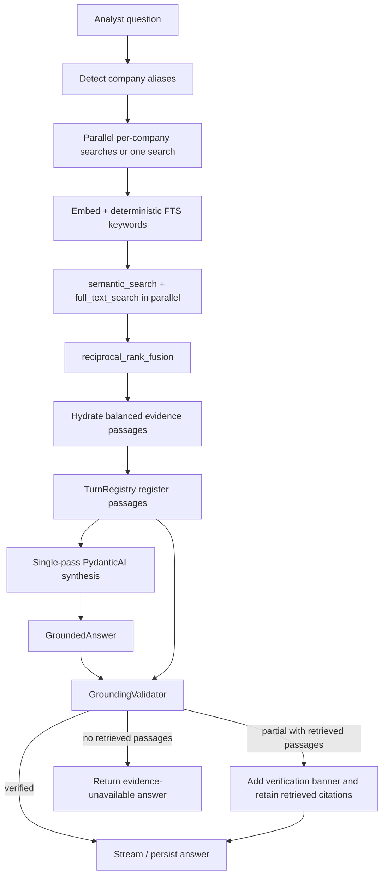

# Research pipeline: retrieval → agent → grounding

End-to-end flow for answering research questions from Indian quick-commerce filing chunks. The chat orchestrator retrieves evidence before generation; the PydanticAI ShelfLife analyst synthesizes a structured answer from numbered passages, and grounding validates citations before the response is shown or persisted.

Retrieval-specific settings and SQL details live in [`../retrieval/README.md`](../retrieval/README.md).

## Full pipeline

The orchestrator contextualizes follow-up questions with the last two conversation turns and the latest user message before retrieval. Gemini rewrites anaphoric or elliptical questions as standalone search queries; a timeout or rate limit falls back to inherited company and metric keywords. Comparative questions then search operational and financial subtopics for each named company concurrently, merge and deduplicate balanced results, and retrieve current evidence for previously established comparison rows. The passages are registered in `TurnRegistry` and injected in full as numbered evidence into a tool-free PydanticAI synthesis call, capped at eight requests. This normally requires one generation request. Citation markers, chunk IDs, and excerpts are normalized against the numbered passages and checked deterministically before emission; no verifier LLM call is made.



## Agent layer

The legacy retrieval-backed tools remain implemented in `tools.py`, but the chat response path pre-retrieves evidence and does not expose tool calls to the synthesis agent:

| Tool | Purpose |
| --- | --- |
| `search_filings` | Hybrid retrieval with optional `ticker`, `form`, `fiscal_years` filters |
| `read_chunks` | Batch-fetch full text for multiple chunk UUIDs in one DB round-trip |
| `read_chunk` | Fetch a single chunk by UUID |
| `read_surrounding_chunks` | Fetch adjacent chunks within the same filing |

Pre-retrieved passages are registered in `TurnRegistry` (`deps.py`). That registry is the **citation allowlist** for the turn — only chunk IDs registered here may appear in the final answer.

### Parallelism

| Layer | What runs in parallel |
| --- | --- |
| Retrieval | `semantic_search` and `full_text_search` use separate DB sessions in a thread pool |
| Company searches | `asyncio.gather` runs separate company-filtered hybrid searches concurrently |
| LLM calls | One structured generation pass |

Keyword extraction and citation verification make no model requests. The tool-free generation agent has an eight-request safety limit; typical chat generation is one request because evidence is already in its prompt. Retrieval, generation, deterministic verification, and total wall time are logged for each completed pipeline turn.

### Structured output

The agent returns `GroundedAnswer` (`outputs.py`):

- `answer` — plain text with `[1]`, `[2]`, … markers
- `citations` — `{citation_index, chunk_id, excerpt}` per cited claim
- `insufficient_evidence` — when the corpus cannot support an answer (must have empty citations)

## Grounding

`GroundingValidator` (`grounding/validator.py`) runs **after** the agent finishes without an LLM call. It checks the answer's citation structure and verifies that cited chunk IDs belong to the turn registry. The orchestrator adds a visible partial-verification banner only when a named company has no retrieved passages while at least one other passage is available. Invalid or unregistered citations are filtered and repaired; when no passages are retrieved, it returns an evidence-unavailable answer instead.

### Checks performed

1. **Non-empty answer** — blank `answer` text fails.
2. **Insufficient-evidence contract** — when `insufficient_evidence=true`, citations must be empty; when `false`, at least one citation is required.
3. **Registry populated** — citations cannot exist if no passages were retrieved.
4. **Citation indices** — must be unique, 1-based, and contiguous (`1..N`).
5. **Marker alignment** — every `[n]` in `answer` must match a `citation_index`, and vice versa.
6. **Chunk allowlist** — each `citation.chunk_id` must exist in `TurnRegistry.passages_by_chunk_id`.
7. **Verbatim excerpts** — each `citation.excerpt` (whitespace-normalized) must be a substring of the retrieved chunk text; malformed excerpts are replaced with text from the registered passage before persistence.

### Where validation runs

| Entry point | Behavior on failure |
| --- | --- |
| `chat/orchestrator.py` | Retains only retrieved citations; shows a partial-coverage banner only when a mentioned company has no retrieved passages |
| `scripts/smoke_assistant.py` | Prints `validation_ok: false` and the error message |

Grounding does **not** call a model, re-retrieve, or re-score passages. It checks citation structure and membership in the evidence boundary established by pre-retrieval during the turn.

## Progress logging (smoke / Jupyter)

`progress.py` exposes optional listeners. `scripts/smoke_assistant.py` registers a listener that prints timestamped lines (flushed) for:

- Agent start and completion (request count, token usage)
- Each legacy tool start and finish (duration, result count)
- Grounding validation result
- Retrieval, generation, verification, and total pipeline durations

In Jupyter, call `setup_progress_logging()` before `run_document_agent` (or run the smoke script as-is) so the cell shows live progress instead of appearing hung.

## Module map

| Path | Responsibility |
| --- | --- |
| `agent.py` | PydanticAI agent definition and `run_document_agent` |
| `tools.py` | Retrieval-backed tools + registry registration |
| `deps.py` | `DocumentAgentDeps`, `TurnRegistry` |
| `outputs.py` | `GroundedAnswer`, `Citation` |
| `instructions.md` | System prompt / product contract |
| `progress.py` | Optional progress listeners |
| `../retrieval/` | Hybrid search implementation |
| `../grounding/validator.py` | Post-agent citation validation |
| `../chat/orchestrator.py` | Agent → validate → stream → persist |

## Smoke test

From `backend/`:

```bash
uv run python -u scripts/smoke_assistant.py
```

Edit `QUERY_KEY` at the top of the script to switch between canned queries. Use `-u` for unbuffered stdout in terminals; the script already flushes prints for Jupyter.
