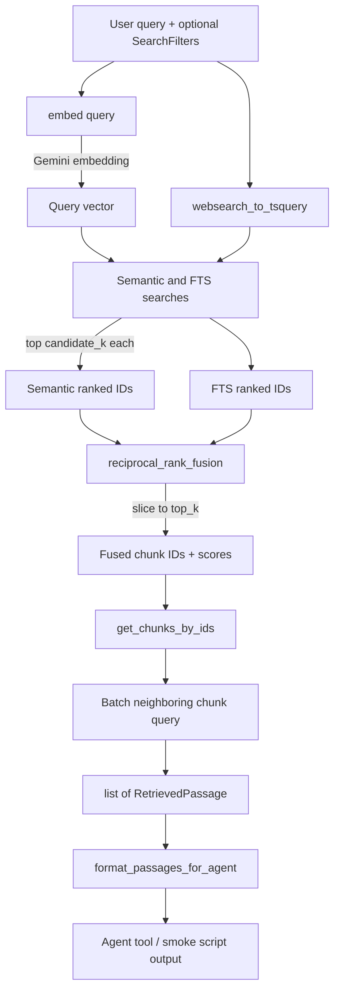

# Retrieval

Hybrid search over Indian quick-commerce annual reports and IPO prospectuses stored in Supabase Postgres. For the full path from analyst question through agent tools to grounding validation, see [`../assistant/README.md`](../assistant/README.md). Each query runs **semantic** (pgvector) and **keyword** (Postgres full-text) searches, fuses the ranked lists with **Reciprocal Rank Fusion (RRF)**, then hydrates the top hits and optional neighboring chunks in the same async database session.

## Pipeline



### Step-by-step

1. **Prepare** — `embed_query` embeds the semantic query. Comparative searches pass the same topic embedding query for each company; `DocumentRetriever` caches the in-flight and completed embedding task so duplicate subtopics are embedded once. Full-text search receives the original query after whitespace trimming; Postgres handles tokenization, stopwords, and stemming.

2. **Search** — Semantic search orders by pgvector cosine distance (`<=>`); score is `1 - distance`. Full-text search uses `websearch_to_tsquery` against the ingest-generated `search_vector` column and ranks with `ts_rank_cd`. Both queries run in the same async session and transaction, with filters applied to both.

3. **Fusion** — `fusion.reciprocal_rank_fusion` merges the two ID lists. Each appearance at rank `r` (1-based) adds `1 / (k + r)` to that chunk's score. Results are sorted by total score descending; the list is truncated to `top_k`.

4. **Hydrate** — `retriever.DocumentRetriever` loads full chunk rows (with parent document) for fused IDs, preserving fusion order in the same session.

5. **Neighbors** — When `include_neighbors=True` (default), one batched query fetches adjacent chunks for all hits within `retrieval_neighbor_radius` indices in each document. Neighbors are attached to the parent passage with `fusion_score=0.0` and deduplicated across hits.

6. **Format** — `types.format_passages_for_agent` turns passages into bounded, grep-style text for agent tools (excerpt and total output caps below).

## Default settings

All retrieval tuning lives in `app/config.py` and can be overridden via environment variables (same field names, e.g. `RETRIEVAL_TOP_K=15`).

| Setting | Default | Role |
| --- | --- | --- |
| `retrieval_candidate_k` | `50` | Max hits fetched from **each** search path before fusion |
| `retrieval_top_k` | `8` | Final number of fused passages returned |
| `retrieval_rrf_k` | `60` | RRF constant `k` in `1 / (k + rank)` |
| `retrieval_neighbor_radius` | `1` | Chunks before/after each hit to include (same document, by `chunk_index`) |
| `retrieval_fts_config` | `"english"` | Allowlisted Postgres text search config (`english` or `simple`) |
| `gemini_model` | `"gemini-3.5-flash-lite"` | Model used for the agent and follow-up contextualization |
| `gemini_fallback_models` | `["gemini-2.5-flash", "gemini-2.5-flash-lite"]` | Models tried after one jittered retry on transient Gemini 429/503 errors |
| `gemini_embedding_model` | `"gemini-embedding-001"` | Model used for document and query embeddings |
| `embedding_dimensions` | `1536` | Embedding width; must match the model and database schema |

### `DocumentRetriever.search` parameters

| Parameter | Default | Role |
| --- | --- | --- |
| `filters` | `None` | Optional `SearchFilters` (see below) |
| `top_k` | `settings.retrieval_top_k` | Override fused result count |
| `candidate_k` | `settings.retrieval_candidate_k` | Override per-path candidate pool |
| `include_neighbors` | `True` | Attach surrounding chunks to each hit |
| `session` | auto | Pass an `AsyncSession` or let the retriever open one async transaction |
| `embedding_query` | `query` | Reuse an embedding for equivalent company-filtered subtopic searches |

### Output formatting limits (`types.py`)

| Constant | Value | Role |
| --- | --- | --- |
| `MAX_PASSAGE_EXCERPT_CHARS` | `800` | Max characters per passage (or neighbor) in agent output |
| `MAX_AGENT_OUTPUT_CHARS` | `12_000` | Max total characters from `format_passages_for_agent` |

## Search filters

`SearchFilters` optionally narrows both semantic and FTS queries:

| Field | Type | SQL effect |
| --- | --- | --- |
| `ticker` | `str \| None` | `sd.ticker = :ticker` |
| `fiscal_years` | `list[int] \| None` | `sd.fiscal_year = ANY(:fiscal_years)` |
| `form` | `str \| None` | `sd.form = :form` |

Unset fields apply no filter. Filters are ANDed together.

## Module map

| File | Responsibility |
| --- | --- |
| `retriever.py` | `DocumentRetriever` orchestrator: embed → search → fuse → hydrate |
| `embeddings.py` | Gemini query embedding |
| `keywords.py` | Whitespace normalization; Postgres owns FTS normalization |
| `queries.py` | pgvector semantic search + Postgres FTS SQL |
| `fusion.py` | Reciprocal Rank Fusion |
| `types.py` | `SearchFilters`, `RetrievedPassage`, agent formatting helpers |

## Quick smoke test

From `backend/`:

```bash
uv run python -m scripts.smoke_retrieval
```

The script runs three company- and filing-scoped questions for Eternal, Swiggy, and Zepto through `DocumentRetriever` and prints `format_passages_for_agent` output.

## RRF in brief

Given rankings `[semantic_ids, fts_ids]` and constant `k`:

```
score(chunk) = Σ  1 / (k + rank_in_list)
```

A chunk that ranks well in **both** lists accumulates a higher score than a chunk that only appears in one. Default `k=60` follows the common RRF literature value and dampens the influence of top ranks vs. lower ranks.
